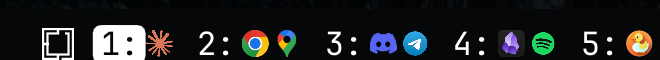

# Workspaces with Window Icons

An [Omarchy](https://omarchy.org/) shell bar widget — a fork of the built-in
`omarchy.workspaces` widget that also shows the icon of each running window
next to its workspace number. Click an icon to switch to that window's
workspace.


## Multiple monitors

Requires [Omarchy 4.5](https://github.com/omacom/omarchy/pull/15655) or newer. Like the built-in widget, it follows Omarchy's
per-monitor workspaces: every monitor has its own workspaces 1-10 (Hyprland
numbers them in blocks of ten - 1-10, 11-20, ...), and each monitor's bar
shows only its own, labeled `1:`-`0:`, with the workspace that monitor is
showing highlighted. Workspaces left over from an unplugged monitor are
listed after a small gap.



## Install

```bash
omarchy plugin add https://github.com/deda/omarchy-workspaces-icons.git --enable
omarchy plugin disable omarchy.workspaces
omarchy restart shell
```

## Manual install

```bash
git clone https://github.com/deda/omarchy-workspaces-icons.git ~/.config/omarchy/plugins/deda.workspaces-icons
omarchy plugin enable deda.workspaces-icons
omarchy plugin disable omarchy.workspaces
omarchy restart shell
```

The shell keeps an already-loaded widget's compiled QML, so after installing
or updating, restart it once to pick up the new code.

## Configuration

The workspace number uses the bar's own font size. To make it smaller or
larger than the rest of the bar, set an offset (in pixels, `-6` to `6`):

```bash
omarchy bar set deda.workspaces-icons fontSizeOffset -2
```

Or edit the widget's entry in `~/.config/omarchy/shell.json` directly, which
hot-reloads on save:

```json
{ "id": "deda.workspaces-icons", "fontSizeOffset": -2 }
```

| Setting | Type | Default | Description |
| --- | --- | --- | --- |
| `fontSizeOffset` | integer, `-6`..`6` | `0` | Pixels added to the bar's font size for the workspace number. `0` matches the rest of the bar. |

## Update

```bash
omarchy plugin update deda.workspaces-icons
omarchy restart shell
```

## Remove

```bash
omarchy plugin remove deda.workspaces-icons
```

## License

[MIT](LICENSE)
